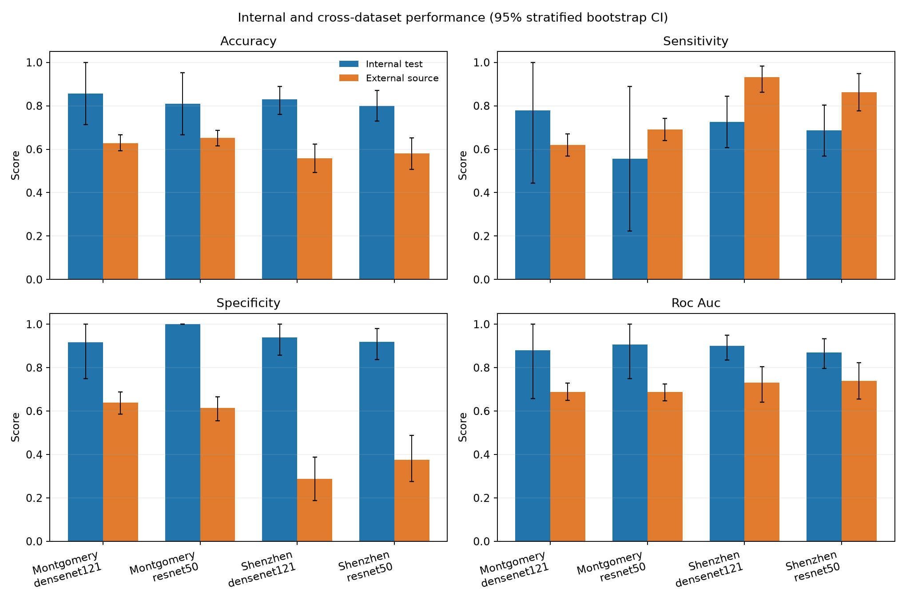

# Tuberculosis Detection from Chest X-Rays Using DenseNet and ResNet

## Abstract

Pulmonary tuberculosis (TB) screening from chest radiographs is a computer-vision task in which small public datasets and acquisition differences can make high in-domain scores misleading. This project compares two ImageNet-pretrained convolutional architectures—DenseNet121 and ResNet50—on the National Library of Medicine (NLM) Shenzhen and Montgomery County chest X-ray collections. It formulates the benchmark as binary classification of normal versus abnormal radiographs carrying TB-associated readings in the source collection; it does not claim a definitive TB diagnosis. For each source, case records are split into stratified training, validation and test partitions (70/15/15). Each architecture is trained on one source, selected using validation loss, tested on the source-specific held-out set, and then evaluated without adaptation on the full, independent second source. Across the four fits, internal AUROC ranged from 0.870 to 0.907, while cross-source AUROC ranged from 0.687 to 0.739; external accuracy ranged from 0.558 to 0.653. Evaluation also reports sensitivity, specificity, accuracy, balanced accuracy, precision, F1, Matthews correlation coefficient (MCC), confusion matrices and class-stratified percentile bootstrap confidence intervals. The implementation includes reproducible data preparation, trained model checkpoints, offline tests, a local inference API and a model card. Results are dataset-specific and the sizeable transport loss, small sample sizes, label semantics and possible confounding rule out clinical interpretation. The system is a research prototype, not a medical device or diagnostic aid.

## 1. Introduction and problem statement

Chest radiography is used in TB screening, but image interpretation can be affected by disease presentation, image quality and reader context. Deep convolutional networks can learn useful image representations, yet they may also learn scanner, site, demographic or preprocessing signals. Consequently, a classifier that appears effective on random within-source splits may fail on a different hospital or acquisition setup. The project addresses the narrower research question: **how do DenseNet121 and ResNet50 compare on two public TB-focused CXR datasets, and how much does performance change when evaluation moves to the other dataset?**

The benchmark is deliberately described as **normal versus abnormal/TB-associated label** rather than active TB diagnosis. The public image labels and radiologist readings are not equivalent to microbiological confirmation, and dataset-level screening results do not demonstrate performance in Nigerian clinics or any deployment setting.

## 2. Aim, objectives and research questions

### Aim

To implement and compare DenseNet121 and ResNet50 transfer-learning classifiers for a public chest-radiograph screening benchmark and quantify their within-source and cross-source generalisation.

### Objectives

1. Acquire and validate the official NLM Shenzhen and Montgomery image collections.
2. Parse the source-provided filename labels and create reproducible, stratified partitions for each collection.
3. Train both architectures under a shared preprocessing, optimizer and checkpoint-selection protocol.
4. Measure discrimination and screening errors on an untouched source-specific test partition and on the other complete dataset.
5. Report uncertainty, dataset limitations, possible shortcut learning and safe-use boundaries.
6. Deliver a tested codebase, runnable inference demo, model card and provenance record.

### Research questions

- RQ1: How do DenseNet121 and ResNet50 compare on the same within-source held-out partition?
- RQ2: How much do sensitivity, specificity and AUROC change when a model is applied to the other source without fine-tuning?
- RQ3: Are apparent architecture differences stable across the two training directions, given the small external test sets and their uncertainty?

## 3. Scope and significance

This is a binary image-level research benchmark on two de-identified public collections of frontal chest radiographs. It is not a clinical workflow; it does not infer infectiousness, distinguish active from healed TB, stage disease, localise lesions, read a full clinical history or replace confirmatory tests. No Nigerian-local dataset is included, so no claim of Nigerian population validity is made. The main value is a transparent implementation that makes external-domain evaluation explicit rather than relying only on one in-source test set.

## 4. Related work

Jaeger et al. describe the two public NLM collections as postero-anterior chest-radiograph datasets from Montgomery County, Maryland, and Shenzhen No. 3 People’s Hospital, with clinical readings. The published counts are 138 Montgomery cases (80 normal, 58 with TB manifestations) and 662 Shenzhen cases (326 normal, 336 TB manifestations). He et al. introduced residual learning, which underlies ResNet, while Huang et al. introduced densely connected convolutional networks, which underlie DenseNet. Both families support transfer learning from large-scale natural-image pretraining; the experiment holds input processing and training settings constant to improve comparability.

A key methodological issue is domain shift. The collections differ by institution, geography, acquisition system, image dimensions, patient mix and case composition. External-source performance can reveal a loss of transportability, although with only 138 records in Montgomery it is imprecisely estimated. A poor external score cannot be attributed to one cause without further controlled studies.

## 5. Materials and methodology

### 5.1 Data source and preparation

The project downloads PNG radiographs from the official NLM public index. Shenzhen images use `CHNCXR_####_0.png` / `CHNCXR_####_1.png` names; Montgomery images use `MCUCXR_####_0.png` / `MCUCXR_####_1.png`. The filename suffix is treated as the source-provided binary label: 0 = normal and 1 = abnormal/TB-associated. The code fails closed on unexpected filenames and unreadable images and records SHA-256 hashes after download.

Each source is stratified separately into 70% training, 15% validation and 15% test records using fixed seed 42. A source record identifier cannot cross partitions. The datasets do not provide a common, cross-source patient identifier in the filename; the partition procedure therefore makes no stronger patient-independence claim than source-record separation. The held-out internal test set is not used for training or checkpoint selection. During cross-source evaluation, every image from the other source is untouched by that model fit.

Radiographs are converted to RGB, resized with aspect ratio preserved and padded to a square, then normalized with ImageNet channel statistics. Training uses a mild ±4° rotation and does not horizontally flip laterality. Validation and test transformations are deterministic.

### 5.2 Model architectures

The compared backbones are Torchvision DenseNet121 and ResNet50 with their default ImageNet pretrained weights. Each ImageNet classification head is replaced with a two-logit binary head. Default transfer learning freezes the pretrained backbone and fits the new head, reducing the number of trainable parameters for the small datasets. `--no-freeze-backbone` enables full-network fine-tuning as a separate, explicitly documented experiment. Model configurations and Torchvision weight status are saved alongside checkpoints.

### 5.3 Training procedure

The four primary fits are:

1. Shenzhen training split → internal Shenzhen test and external Montgomery dataset.
2. Montgomery training split → internal Montgomery test and external Shenzhen dataset.

Each fit uses AdamW (learning rate 0.0005, weight decay 0.0001), batch size 8, up to 8 epochs, cross-entropy loss and early stopping after 3 non-improving validation-loss epochs. The checkpoint with the lowest validation loss is selected. Seed 42 is used for data partitions and training RNGs. The default is CPU/GPU auto-detection. Configuration can be changed on the command line; any deviations must be recorded when interpreting results.

### 5.4 Evaluation measures

At a fixed, prespecified threshold of 0.5, the test report includes accuracy, balanced accuracy, sensitivity/recall for class 1, specificity for class 0, precision, F1, AUROC, MCC and the confusion matrix. Class-stratified percentile bootstrap 95% confidence intervals are computed for accuracy, sensitivity, specificity and AUROC, with sampling performed separately within each reference class. The threshold is not tuned on the test set. Model scores are not calibrated probabilities.

## 6. System implementation

The project is a Python package (`tb_cxr`) with scripts for direct NLM downloading and manifest preparation. `experiment.py` executes the four fits and persists checkpoints, metadata, learning curves, prediction tables, JSON metrics, confusion plots, confidence-interval comparison charts, explicit external-minus-internal gaps and an aggregate CSV/JSON. The FastAPI demo exposes model listing and single-image inference locally. Image bytes are handled in memory and are not persisted. The front end presents a visible research-only warning. Unit tests use small synthetic fixtures only to check parsing and split mechanics; such fixtures never enter reported experiments. The benchmark run itself uses the official NLM images.

## 7. Results and discussion

The observed performance is summarised below; confidence intervals, all eight evaluation rows and confusion counts are in [`RESULTS.md`](RESULTS.md). The accuracy difference is external minus internal, in percentage points.

| Training source | Architecture | Internal accuracy / AUROC | External accuracy / AUROC | Accuracy change | AUROC change |
|---|---|---:|---:|---:|---:|
| Montgomery | DenseNet121 | 85.7% / 0.880 | 62.8% / 0.687 | −22.9 pp | −0.193 |
| Montgomery | ResNet50 | 81.0% / 0.907 | 65.3% / 0.687 | −15.7 pp | −0.220 |
| Shenzhen | DenseNet121 | 83.0% / 0.900 | 55.8% / 0.731 | −27.2 pp | −0.169 |
| Shenzhen | ResNet50 | 80.0% / 0.870 | 58.0% / 0.739 | −22.0 pp | −0.131 |

Both architectures lose discrimination externally, and neither consistently outperforms the other across the four comparisons. At threshold 0.5, Shenzhen-trained models applied to Montgomery achieve high sensitivity (0.862–0.931) but low specificity (0.288–0.375), with many false positives. Montgomery-trained models applied to Shenzhen have more balanced but substantially lower sensitivity and specificity (0.613–0.690). These results indicate source-dependent behavior in this benchmark, not a validated screening trade-off. The Montgomery internal test set contains only 21 images, so its internal metrics are imprecise. The bootstrap intervals reflect finite-sample uncertainty but do not capture all sources of bias, label noise or dataset selection.

**Important:** the NLM collections are small and may exhibit shortcut cues. These values do not establish clinical safety, clinical utility or generalisation to unseen hospitals. The research question is about benchmark portability, not the validity of automated TB screening in practice.

## 8. Limitations, ethics and safety

- Source annotations are not an independent microbiological gold standard; suffix 1 represents the collection's abnormal/TB-associated label.
- Montgomery is small, so external metrics can vary substantially with individual cases.
- The two-source comparison cannot isolate scanner, geography, patient mix, acquisition, clinical workflow or image-processing effects.
- Public filename identifiers do not provide a cross-source patient identity system; split safety is record-level.
- The study uses no Nigerian clinical data, prospective cohort, calibration study, reader comparison, subgroup audit or clinical impact evaluation.
- ImageNet weights may contribute generic but not clinically validated representations; the binary score is not calibrated.
- The model is unsuitable for patient care, triage, treatment decisions, or public-health policy. A qualified clinician and confirmatory clinical testing remain necessary.
- Download and redistribution should follow the current NLM dataset terms and any relevant institutional/academic policies. Do not place identifiable patient images in the demo.

## 9. Conclusion and future work

This project operationalises an architecture comparison together with bidirectional external-source testing on the two NLM public CXR collections. The implementation makes its labels, split strategy and intended-use boundary explicit. Any architecture advantage must be judged alongside external-domain degradation and uncertainty, not only internal accuracy. Future work should use larger, independently curated, geographically diverse datasets with harmonised reference standards, patient-level linkage where appropriate, subgroup and calibration analysis, and prospective evaluation under ethics and clinical governance. None of those future requirements is fulfilled by this prototype.

## References

1. Jaeger S, Candemir S, Antani S, Wang Y-XJ, Lu P-X, Thoma G. **Two public chest X-ray datasets for computer-aided screening of pulmonary diseases.** *Quantitative Imaging in Medicine and Surgery*. 2014;4(6):475–477. [doi:10.3978/j.issn.2223-4292.2014.11.20](https://doi.org/10.3978/j.issn.2223-4292.2014.11.20). [Full text](https://pmc.ncbi.nlm.nih.gov/articles/PMC4256233/).
2. U.S. National Library of Medicine. **Tuberculosis Chest X-ray Datasets: public index.** [Official download index](https://data.lhncbc.nlm.nih.gov/public/Tuberculosis-Chest-X-ray-Datasets/).
3. He K, Zhang X, Ren S, Sun J. **Deep Residual Learning for Image Recognition.** *Proceedings of CVPR*. 2016. [doi:10.1109/CVPR.2016.90](https://doi.org/10.1109/CVPR.2016.90); [CVF open-access paper](https://openaccess.thecvf.com/content_cvpr_2016/html/He_Deep_Residual_Learning_CVPR_2016_paper.html).
4. Huang G, Liu Z, Van Der Maaten L, Weinberger KQ. **Densely Connected Convolutional Networks.** *Proceedings of CVPR*. 2017. [doi:10.1109/CVPR.2017.243](https://doi.org/10.1109/CVPR.2017.243); [CVF open-access paper](https://openaccess.thecvf.com/content_cvpr_2017/html/Huang_Densely_Connected_Convolutional_CVPR_2017_paper.html).
5. PyTorch/Torchvision. **Pretrained model weights and model implementation documentation.** [Torchvision models](https://pytorch.org/vision/stable/models.html).
